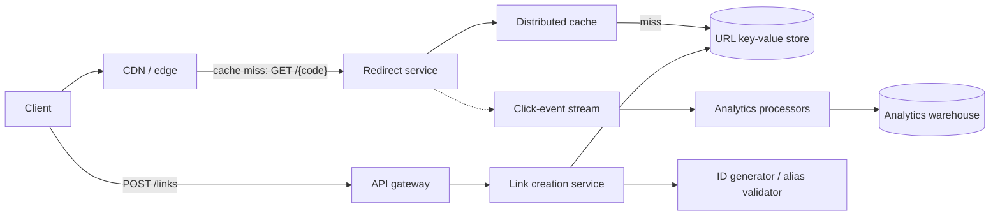
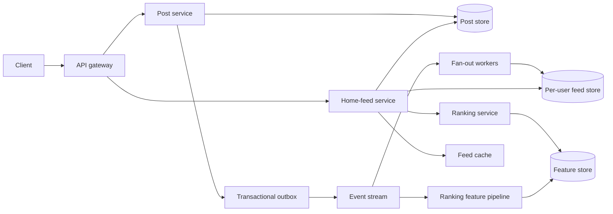
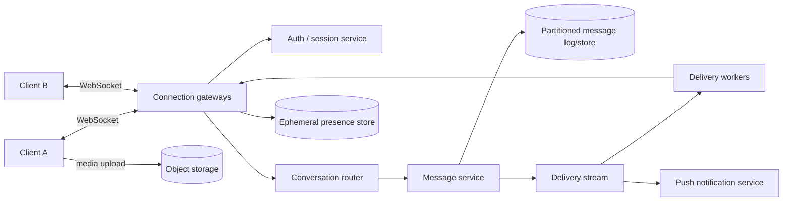
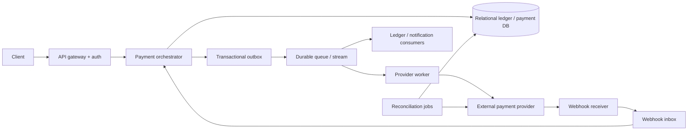
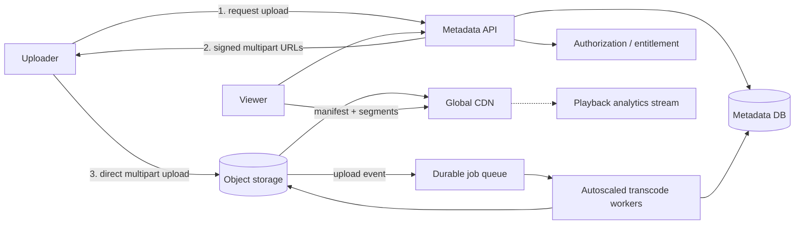
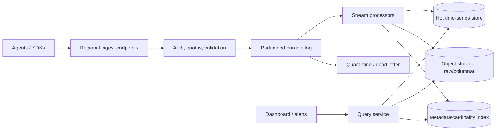

# System Design Architecture Decisions and Trade-offs Cheat Sheet

> A cloud-neutral, interview-focused handbook for senior and staff-level engineers. Use it to turn vague requirements into a defensible design, explain why each component exists, expose trade-offs, and evolve the system safely.

## Table of Contents

- [1. The Senior-Level Interview Mindset](#1-the-senior-level-interview-mindset)
- [2. A Repeatable 45–60 Minute Interview Flow](#2-a-repeatable-4560-minute-interview-flow)
- [3. Requirements and Constraints Checklist](#3-requirements-and-constraints-checklist)
- [4. Back-of-the-Envelope Estimation](#4-back-of-the-envelope-estimation)
- [5. Core Architecture Decision Matrix](#5-core-architecture-decision-matrix)
- [6. Data and Consistency Decisions](#6-data-and-consistency-decisions)
- [7. Communication and Integration Decisions](#7-communication-and-integration-decisions)
- [8. Scaling, Reliability, and Disaster Recovery](#8-scaling-reliability-and-disaster-recovery)
- [9. Caching and Content Delivery](#9-caching-and-content-delivery)
- [10. Security, Privacy, and Abuse Prevention](#10-security-privacy-and-abuse-prevention)
- [11. Observability and Operability](#11-observability-and-operability)
- [12. Architecture and Delivery Trade-offs](#12-architecture-and-delivery-trade-offs)
- [13. Common Patterns and Their Costs](#13-common-patterns-and-their-costs)
- [14. Worked Architecture 1: URL Shortener](#14-worked-architecture-1-url-shortener)
- [15. Worked Architecture 2: Social Home Feed](#15-worked-architecture-2-social-home-feed)
- [16. Worked Architecture 3: Real-Time Chat](#16-worked-architecture-3-real-time-chat)
- [17. Worked Architecture 4: Payment Processing](#17-worked-architecture-4-payment-processing)
- [18. Worked Architecture 5: Video Streaming Platform](#18-worked-architecture-5-video-streaming-platform)
- [19. Worked Architecture 6: Multi-Tenant Metrics Platform](#19-worked-architecture-6-multi-tenant-metrics-platform)
- [20. Evolution, Migration, and Cost](#20-evolution-migration-and-cost)
- [21. Senior-Level Follow-up Questions](#21-senior-level-follow-up-questions)
- [22. Anti-Patterns and Interview Traps](#22-anti-patterns-and-interview-traps)
- [23. Final Answer Template](#23-final-answer-template)
- [24. Rapid Revision Tables](#24-rapid-revision-tables)

---

## 1. The Senior-Level Interview Mindset

System design is not a catalog of technologies. It is a sequence of decisions under constraints.

A strong senior-level answer does five things:

1. **Clarifies the product contract**: users, use cases, correctness, latency, availability, security, and scope.
2. **Quantifies the design**: traffic, storage, bandwidth, concurrency, hot keys, and growth.
3. **Chooses the simplest architecture that meets the stated needs**.
4. **Explains trade-offs and failure behavior**: not just the happy path.
5. **Shows an evolution path**: launch design, scale triggers, migrations, operations, and cost.

### The decision statement to use throughout the interview

> We choose **X** over **Y** because **requirement R** matters more than **cost C**. The downside is **D**. We will detect when that trade-off stops being valid using **metric M**, then evolve to **Z**.

Example:

> We choose a relational database over a document store because payment state requires transactions, uniqueness constraints, and audit-friendly queries. The downside is harder horizontal write scaling. We will monitor writer utilization, lock wait time, and replication lag; partitioning by merchant is a later option.

### What changes at 12+ years of experience

An experienced candidate is expected to discuss more than component selection:

| Area | Expected senior-level signal |
|---|---|
| Ambiguity | Converts business language into explicit SLOs and invariants |
| Trade-offs | Names what is sacrificed, not only what is gained |
| Failure | Describes timeouts, retries, overload, partial failure, and recovery |
| Data | Defines ownership, lifecycle, consistency, deletion, and reconciliation |
| Operations | Covers rollout, observability, on-call, capacity, and runbooks |
| Evolution | Avoids a big-bang design; gives triggers for the next stage |
| Organization | Aligns service boundaries with ownership and team topology |
| Cost | Identifies dominant cost drivers and graceful degradation options |
| Risk | Separates reversible decisions from expensive, one-way choices |

---

## 2. A Repeatable 45–60 Minute Interview Flow

| Time | Activity | Output |
|---:|---|---|
| 0–5 min | Clarify scope and users | Two or three primary use cases; explicit exclusions |
| 5–10 min | Establish NFRs and invariants | Scale, SLOs, consistency, security, RTO/RPO |
| 10–15 min | Estimate | QPS, concurrency, storage, bandwidth, hot-key risk |
| 15–25 min | Define APIs and data model | Contracts, entities, access patterns, ownership |
| 25–38 min | Draw the high-level design | Request paths, stores, queues, caches, boundaries |
| 38–50 min | Deep dive on the hardest part | Scaling, consistency, ordering, ranking, or transactions |
| 50–57 min | Failures, operations, security, cost | Degradation, recovery, observability, abuse controls |
| 57–60 min | Summarize and evolve | Key decisions, trade-offs, next scaling trigger |

### Recommended order of reasoning

```text
Product contract
  -> workload and constraints
  -> invariants and access patterns
  -> APIs and data model
  -> simplest viable architecture
  -> bottlenecks and failure modes
  -> scaling and recovery
  -> security, operations, cost
  -> evolution triggers
```

Do not start by drawing boxes. A box has no justification until the requirement and access pattern are known.

---

## 3. Requirements and Constraints Checklist

### Functional requirements

- Who are the actors: end users, administrators, partners, internal systems?
- What are the top two or three user journeys?
- What reads and writes occur in each journey?
- Does the product require search, ranking, analytics, notifications, sharing, or moderation?
- Are operations synchronous, asynchronous, scheduled, or streaming?
- What is explicitly out of scope?

### Non-functional requirements

| Dimension | Questions to ask | Why it changes the design |
|---|---|---|
| Scale | DAU/MAU, peak QPS, object count, object size, growth? | Determines partitioning, caching, bandwidth, and cost |
| Latency | p50, p95, p99 target? Read and write separately? | Drives locality, cache, fan-out, indexes, and sync depth |
| Availability | 99.9%, 99.99%, or best effort? Per operation? | Changes redundancy, failover, and cost dramatically |
| Durability | Can acknowledged data ever be lost? | Determines replication, quorum, logs, and backup policy |
| Consistency | Which reads must observe which writes? | Determines store, routing, replication, and workflow |
| Ordering | Global, per user, per account, or none? | Global order is costly; narrow the ordering domain |
| Freshness | Milliseconds, seconds, minutes, or daily? | Separates online path from async/materialized views |
| Recovery | RTO and RPO? Region or dependency failure? | Determines active-active vs warm standby and data replication |
| Security | Auth model, PII, tenancy, data residency, audit? | Determines boundaries, encryption, access, and region strategy |
| Cost | Budget or cost per request/tenant? | Changes managed vs self-hosted and storage/compute choices |
| Operability | Team size, expertise, on-call maturity? | Complex distributed systems have a recurring human cost |

### Define invariants before architecture

An invariant is a condition the system must never violate.

Examples:

- A payment is captured at most once for a given idempotency key.
- Inventory never becomes negative.
- A user cannot read another tenant's private records.
- An acknowledged chat message is not silently lost.
- Only one active username may exist for a normalized value.

Strong consistency is rarely needed for everything. Apply it narrowly around invariants; allow eventual consistency for derived views, counters, search indexes, recommendations, and analytics.

### Availability is operation-specific

Avoid saying, “the system is highly available.” State which operations may degrade:

| Failure | Preferred product behavior |
|---|---|
| Recommendation service down | Show popular or cached content |
| Search index lagging | Serve slightly stale results |
| Payment provider times out | Return pending; reconcile asynchronously |
| Comment write path down | Preserve draft; retry safely |
| Analytics pipeline down | Buffer events; do not block checkout |
| Authorization service uncertain | Fail closed for privileged operations |

---

## 4. Back-of-the-Envelope Estimation

Estimates identify architectural pressure; they are not precision forecasts.

### Useful formulas

```text
Average QPS       = requests per day / 86,400
Peak QPS          = average QPS × peak factor (often 3–10)
Concurrent work   = arrival rate × average time in system
Daily storage     = writes/day × average record size × replication factor
Annual storage    = daily storage × 365 × retention adjustment
Network bandwidth = requests/second × payload bytes
Cache memory      = hot objects × average object size × overhead
Availability      = successful eligible requests / eligible requests
```

Little's Law:

```text
Concurrency = throughput × latency

Example: 8,000 requests/s × 0.2 s = 1,600 in-flight requests
```

### Approximate powers of two

| Power | Approximate value | Storage intuition |
|---:|---:|---|
| 2^10 | 1 thousand | KiB |
| 2^20 | 1 million | MiB |
| 2^30 | 1 billion | GiB |
| 2^40 | 1 trillion | TiB |

### Example estimate

Assume 20 million daily active users, 40 reads and 2 writes per user per day:

```text
Reads/day       = 20M × 40 = 800M
Average read QPS= 800M / 86,400 ≈ 9.3K
Peak read QPS   = 9.3K × 6 ≈ 56K

Writes/day      = 20M × 2 = 40M
Average write QPS ≈ 463
Peak write QPS  ≈ 2.8K

If one write is 2 KiB:
Raw data/day    = 40M × 2 KiB ≈ 80 GiB/day
With 3 replicas = ≈ 240 GiB/day before indexes and compression
```

What this reveals:

- The workload is read-heavy, so cache and read replicas/materialized views may help.
- Peak, not average, determines serving capacity.
- Indexes, logs, backups, and replicas often make stored bytes several times the logical size.

### Capacity questions interviewers expect

- Is traffic bursty, diurnal, regional, or event-driven?
- Are a few tenants or keys responsible for most load?
- What is the read/write ratio?
- Can work queue temporarily, or must it complete online?
- What is the largest object and largest fan-out?
- What happens during replay, backfill, or regional recovery?

---

## 5. Core Architecture Decision Matrix

### Compute

| Choice | Prefer when | Trade-offs / avoid when |
|---|---|---|
| Serverless functions | Bursty, event-driven, short, stateless work; small ops team | Cold starts, execution/runtime limits, per-invocation cost, provider coupling |
| Managed containers | Long-running services; custom runtime; predictable scaling | More deployment and capacity policy than functions |
| Kubernetes | Many services/teams need a common extensible platform and portability | High platform and cognitive cost; poor default for a small system |
| Virtual machines | OS/kernel control, legacy software, special networking, stable workloads | Patching, slower scaling, capacity management |
| Batch platform | Queued CPU/GPU jobs with flexible completion time | Not suitable for interactive latency |

**Default:** use the highest-level managed compute that meets runtime, latency, and control requirements. “Managed” transfers toil, not accountability.

### Load balancing and routing

| Need | Choice | Key caveat |
|---|---|---|
| HTTP routing, TLS, host/path rules | Layer 7 load balancer/API gateway | Adds request parsing and usually more cost/latency |
| Very high TCP/UDP throughput | Layer 4 load balancer | Less application-aware routing |
| API auth, quotas, keys, transformations | API gateway | Can be costly at extreme throughput; has payload/time limits |
| Global static and cacheable content | CDN/edge network | Invalidation and cache-key correctness are hard |
| Global dynamic traffic | Global routing/anycast + regional load balancers | Health detection and state/data locality remain your problem |

### Storage

| Storage | Best for | Poor fit |
|---|---|---|
| Object store | Blobs, media, backups, logs, data lakes | Low-latency random mutation or POSIX semantics |
| Block store | Database volumes, low-latency filesystem for one host | Shared access across many hosts |
| Distributed file store | Shared files, legacy POSIX workloads | Massive immutable blob serving; often costlier than object storage |
| Local/ephemeral disk | Cache, shuffle, rebuildable temp data | Durable source of truth |

### Data store quick selector

| Requirement dominates | Likely starting point | Why |
|---|---|---|
| Transactions, constraints, joins | Relational DB | ACID, mature indexing, flexible queries |
| Key-based access at huge scale | Distributed key-value DB | Predictable partitioned reads/writes |
| Aggregate-shaped records, evolving schema | Document DB | Natural document retrieval and flexible fields |
| Relationship traversal | Graph DB | Efficient multi-hop graph queries |
| Full-text relevance and faceting | Search engine | Inverted index and scoring |
| Time-window aggregation | Time-series DB | Compression, retention, time-oriented queries |
| Analytical scans across large history | Columnar warehouse/lakehouse | Column pruning and distributed scans |
| Sub-millisecond transient access | In-memory cache | Speed; not normally the durable source of truth |

### Relational vs non-relational

| Dimension | Relational | Non-relational |
|---|---|---|
| Schema | Explicit; migration required | Often flexible; validation moves to application |
| Transactions | Rich, multi-row/table | Often narrower or store-specific |
| Queries | Joins and ad hoc access | Optimized around known access patterns |
| Scaling | Usually scale-up, replicas, then partition | Partitioning often native |
| Integrity | Constraints and referential integrity | Frequently enforced in application/workflow |
| Best default | Correctness-heavy systems and uncertain queries | Known access patterns or extreme scale/specialized models |

**Important:** “NoSQL scales; SQL does not” is false. Both can scale. The real differences are query model, transactional scope, operational model, and how much complexity the application absorbs.

---

## 6. Data and Consistency Decisions

### Start from access patterns

For each entity, write:

```text
Entity: Order
Write: create by idempotency key; update status conditionally
Reads: by order_id; recent orders by customer_id; unsettled orders by status/time
Volume: 10K peak writes/s; 2-year hot retention
Invariant: legal state transitions; no duplicate charge
Consistency: strong for status transition; eventual for customer history/search
```

This usually determines keys, indexes, partitioning, and which views can be asynchronous.

### Consistency models

| Model | Guarantee | Use when | Cost |
|---|---|---|---|
| Linearizable/strong | Read reflects the latest completed write | Money, uniqueness, locks, inventory invariant | Coordination, latency, reduced availability during partitions |
| Sequential | Operations appear in one legal order | Ordered collaborative or coordination workflows | Coordination overhead |
| Read-your-writes | A client sees its own completed writes | Profiles, post creation UX | Session affinity, tokens, or primary reads |
| Monotonic reads | A client never moves backward in observed state | Timelines and replicated reads | Version tracking/routing |
| Causal | Related events are observed in causal order | Conversations and collaboration | Metadata and implementation complexity |
| Eventual | Replicas converge if writes stop | Feeds, likes, search, analytics | Stale reads and conflict handling |

### CAP in practical terms

During a network partition, a distributed operation must choose between:

- **Consistency:** reject or delay some operations rather than return conflicting state.
- **Availability:** accept/serve operations and reconcile divergence later.

CAP does not mean selecting “CP” or “AP” for an entire product. Make the decision per operation. A cart may favor availability; payment capture should favor consistency.

### PACELC

Even without a partition (**E**lse), choose between **L**atency and **C**onsistency. Cross-region synchronous writes improve consistency but add round-trip latency to every write.

### Replication

| Model | Benefit | Cost / risk |
|---|---|---|
| Single leader | Simple conflict model and ordering | Leader bottleneck/failover pause; replica lag |
| Multi-leader | Regional write locality and disconnected writes | Conflicts, complex resolution, uniqueness is hard |
| Leaderless/quorum | Availability and tunable consistency | Conflict/version handling; operational complexity |
| Synchronous replica | Low data loss on failover | Higher latency; correlated failure can still matter |
| Asynchronous replica | Low write latency, distant replicas | Non-zero RPO and stale reads |

Quorum intuition for `N` replicas:

```text
If W + R > N, read and write quorums overlap.
```

This alone does not guarantee linearizability; sloppy quorums, clocks, concurrent writes, and repair behavior matter.

### Partitioning/sharding

| Strategy | Strength | Weakness |
|---|---|---|
| Hash by key | Even distribution | Range scans and resharding are harder |
| Range by key/time | Efficient range scans | Hot partitions from sequential or time-based writes |
| Directory-based | Flexible placement | Directory becomes critical infrastructure |
| Geographic | Locality and residency | Cross-region queries and moving users are complex |
| Tenant-based | Isolation and operability | Large tenants create skew |

Good partition keys have high cardinality, even distribution, query alignment, and low cross-partition transaction demand.

#### Hot-key mitigation

- Add a calculated suffix/bucket to write-heavy keys.
- Cache hot reads and request-coalesce misses.
- Replicate immutable hot objects.
- Apply per-key rate limits and backpressure.
- Precompute high-demand results.
- Isolate very large tenants or celebrities.

### Index trade-offs

Every index speeds some reads but adds:

- write amplification;
- storage and cache pressure;
- replication and backup volume;
- migration/rebuild cost;
- potential lock or compaction overhead.

Index for demonstrated access patterns. For many optional filters, a search index or analytical store is usually better than a combinatorial set of database indexes.

### Transactions across services

Prefer local database transactions. If a business operation spans services:

| Pattern | Use | Cost |
|---|---|---|
| Saga | Sequence of local transactions with compensations | Temporary inconsistency; compensation is business logic |
| Transactional outbox | Atomically store domain change and event-to-publish | Relay and deduplication required |
| Inbox/dedup table | Prevent duplicate consumer effects | State retention and cleanup required |
| Two-phase commit | Strict atomicity across prepared participants | Blocking, coordinator dependence, poor fit for loosely coupled services |

### Data ownership rule

One service should own mutation of a data set. Other services consume APIs or published events. Shared-database microservices couple schema, deploys, failures, and access control even if their code is separate.

---

## 7. Communication and Integration Decisions

### Synchronous vs asynchronous

| Synchronous call | Asynchronous message |
|---|---|
| Immediate answer and simple control flow | Temporal decoupling and load buffering |
| Caller waits and inherits dependency latency | Caller can proceed after durable acceptance |
| Failure propagates through call chain | Retries/replay and eventual completion |
| Easier debugging for short paths | Harder tracing and duplicate/out-of-order handling |
| Good for queries and validation | Good for side effects, fan-out, workflows, and burst absorption |

Keep the synchronous critical path shallow. Move nonessential actions—email, analytics, indexing, thumbnails—to asynchronous processing.

### Queue vs log/stream vs pub/sub

| Primitive | Semantics | Choose it for |
|---|---|---|
| Work queue | One worker processes each item; visibility/ack | Jobs, smoothing bursts, competing consumers |
| Durable log/stream | Ordered partitions; consumers track offsets; replay | Event pipelines, CDC, multiple independent consumers |
| Pub/sub | Broadcast to subscribers, often ephemeral or broker-retained | Notifications and fan-out |
| Event bus | Attribute/content routing among domains | Integration events and loosely coupled workflows |

### Delivery semantics

| Claim | Reality / design response |
|---|---|
| At-most-once | May lose work; no duplicates |
| At-least-once | No silent loss after durable acceptance, but duplicates are normal |
| Exactly-once delivery | Usually bounded to a broker or processing transaction, not external side effects |
| Effectively-once outcome | At-least-once delivery + idempotent/transactional consumer + deduplication |

Idempotency pattern:

```text
1. Client sends stable idempotency_key.
2. Service atomically reserves key or reads previous result.
3. Business state transition commits once.
4. Retries return the stored result.
5. Key retention matches the realistic retry window.
```

### Retry policy

Use bounded exponential backoff with jitter. Retry only transient failures.

```text
delay = random(0, min(cap, base × 2^attempt))
```

Do not blindly retry validation errors, authorization failures, or deterministic conflicts. Respect an overall deadline and retry budget. Retries multiply overload.

### Ordering

Ask for the narrowest necessary ordering domain:

- Global ordering: expensive bottleneck and rarely necessary.
- Per tenant/account/conversation ordering: partition by that identifier.
- Per entity ordering: use versions, conditional updates, or a single partition.
- No ordering: maximize parallelism.

### Orchestration vs choreography

| Orchestration | Choreography |
|---|---|
| Central workflow knows steps and state | Services react to events independently |
| Easier visibility, timeouts, and compensation | Low central coupling and easy fan-out |
| Workflow can become a controlling hub | End-to-end flow becomes hard to understand |
| Good for payments/order fulfillment | Good for independent notifications/projections |

Use orchestration for business-critical multi-step workflows; use choreography for independent reactions to facts.

### Backpressure and overload

An overloaded system must reject, queue, shed, or degrade work—it cannot “autoscale” out of every spike.

- Bound queues and concurrency.
- Rate-limit at the edge and per tenant.
- Use admission control before scarce dependencies.
- Propagate deadlines and cancellation.
- Shed optional work first.
- Use circuit breakers carefully; they protect a dependency but do not create capacity.
- Expose queue age, not only queue depth. Age reflects user impact.

---

## 8. Scaling, Reliability, and Disaster Recovery

### Scale-up vs scale-out

| Scale up | Scale out |
|---|---|
| Simple and often the best early move | Higher ceiling and fault distribution |
| Limited by largest node; larger blast radius | Requires partitioning, coordination, and load balancing |
| Fewer distributed-system failure modes | More operational complexity and network failure modes |

### Stateless services

Keep durable session/business state outside application instances. Stateless instances enable horizontal scaling, replacement, and safer deploys. In-memory state is acceptable only if it is disposable or reconstructed.

### Availability math

For serial dependencies, approximate availability multiplies:

```text
Three serial dependencies at 99.9% each:
0.999 × 0.999 × 0.999 ≈ 99.7%
```

This is why a long synchronous call chain damages both latency and availability. Real failures are often correlated, so independence assumptions can be optimistic.

### SLO and error budget

| Concept | Meaning |
|---|---|
| SLI | Measured indicator: successful requests, latency, freshness, durability |
| SLO | Target for an SLI over a window |
| SLA | External commitment with consequences |
| Error budget | Allowed unreliability: `1 − SLO` |

Examples over 30 days:

| SLO | Approximate allowed unavailability |
|---:|---:|
| 99.9% | 43.2 minutes |
| 99.95% | 21.6 minutes |
| 99.99% | 4.32 minutes |

Measure user-visible outcomes, not host uptime. A server can be healthy while checkout is failing.

### Failure-domain checklist

- Process/container
- Host/node
- Rack or zone
- Region
- Network partition and DNS
- Database primary or shard
- Third-party API
- Identity/KMS/control plane
- Bad deployment or configuration
- Credential/certificate expiration
- Data corruption or operator mistake
- Traffic spike, retry storm, or abusive tenant

### Resilience mechanisms and costs

| Mechanism | Protects against | Hidden cost |
|---|---|---|
| Redundancy across zones | Zone/host failure | Cross-zone traffic; correlated software bugs remain |
| Timeout | Stuck dependency and resource leak | Too short creates false failures |
| Retry with jitter | Transient failure | Amplifies load and duplicates effects |
| Circuit breaker | Repeated calls to failing dependency | Tuning and recovery oscillation |
| Bulkhead | One workload exhausting all resources | Lower utilization and extra capacity pools |
| Queue | Bursts and temporary consumer outage | Staleness, duplicate work, unbounded backlog risk |
| Cache | Dependency load and latency | Staleness, stampede, invalidation complexity |
| Graceful degradation | Preserves core journey | Product and testing complexity |

### Disaster recovery

| Strategy | RTO/RPO tendency | Cost | Use when |
|---|---|---:|---|
| Backup and restore | Hours/days; non-zero RPO | Low | Long outage is acceptable |
| Pilot light | Tens of minutes/hours | Low–medium | Core data/services ready, compute scales on disaster |
| Warm standby | Minutes | Medium–high | Reduced-capacity secondary is continuously running |
| Active-active | Seconds/minutes; potentially low RPO | Highest | Regional outage tolerance and global latency justify complexity |

**RTO** is how long recovery may take. **RPO** is how much committed data may be lost.

Backups are not a recovery strategy until restoration is automated, timed, verified, and practiced. Multi-region deployment does not protect against bad writes replicated everywhere.

### Failover questions

- What detects failure, and how quickly without false positives?
- Who decides to fail over—automatic or human?
- Is data sufficiently current in the target?
- Can the target handle full load?
- What happens to in-flight writes?
- How is split-brain prevented?
- How do we fail back?

---

## 9. Caching and Content Delivery

### Where to cache

```text
Client/browser -> CDN/edge -> API gateway/proxy -> service cache -> database cache
```

Each layer has different trust, invalidation, personalization, and observability properties.

### Cache patterns

| Pattern | Behavior | Trade-off |
|---|---|---|
| Cache-aside | App reads cache, loads DB on miss | Simple; stale window and stampede risk |
| Read-through | Cache loads backing store | Cleaner app; cache-provider coupling |
| Write-through | Write cache and backing store synchronously | Fresh cache; higher write latency |
| Write-behind | Cache accepts then asynchronously persists | Fast; durability/ordering complexity |
| Refresh-ahead | Refresh hot keys before expiry | Good latency; may refresh unused data |

### Invalidation options

| Strategy | Best when | Risk |
|---|---|---|
| TTL only | Staleness is acceptable | Stale until expiry |
| Explicit invalidation | Writes are controlled and keys known | Lost invalidation creates long staleness |
| Versioned keys | Immutable/versioned resources | Old versions consume space until eviction |
| Event-driven update | Many derived caches/views | Event lag, duplicates, ordering |

### Cache failure modes

- **Stampede:** many misses hit the database together. Use request coalescing/single-flight, jittered TTL, and stale-while-revalidate.
- **Hot key:** one item dominates a cache node. Replicate, shard the key, use local/edge cache, or rate-limit.
- **Penetration:** repeated misses for nonexistent keys. Cache negative results briefly; validate input; optionally use a probabilistic membership filter.
- **Avalanche:** many keys expire together. Add TTL jitter and stagger refresh.
- **Poisoning/leakage:** incorrect cache key mixes users or authorization contexts. Include all response-varying dimensions and never rely on cache as authorization.

### CDN decisions

Use a CDN for cacheable static/media content and sometimes cacheable APIs. Benefits include latency, origin protection, bandwidth offload, and DDoS absorption. Costs include invalidation complexity, regional cache misses, signed URL/cookie management, and accidental private-content caching.

---

## 10. Security, Privacy, and Abuse Prevention

Security is an architectural property, not a final box.

### Threat-oriented checklist

- Who authenticates users and services?
- Where is authorization enforced? Is tenant scope included in every access?
- Are credentials short-lived and rotated?
- Is data encrypted in transit and at rest? Who controls keys?
- Where are secrets stored, and can applications avoid reading long-lived secrets?
- Which data is PII/financial/health data? What are residency and retention rules?
- Are privileged actions immutably audited?
- Can a compromised service reach every database?
- What prevents scraping, credential stuffing, spam, and resource exhaustion?
- How does deletion propagate to caches, replicas, indexes, backups, and analytics?

### Authentication vs authorization

- **Authentication:** who are you?
- **Authorization:** may you perform this action on this resource in this tenant and state?

Check authorization at the trusted service boundary, not only at the UI or gateway. Use deny-by-default and least privilege.

### Tenant isolation models

| Model | Isolation | Cost/operations | Typical use |
|---|---|---|---|
| Shared tables with tenant key | Logical | Lowest cost; must prevent query omissions | Many small tenants |
| Separate schema/database | Stronger logical boundary | More migrations and connections | Medium/regulatory tiers |
| Separate deployment/account | Strongest blast-radius boundary | Highest cost and fleet complexity | Large or regulated customers |

Hybrid isolation is common: shared default, dedicated cells for large or regulated tenants.

### Rate limiting algorithms

| Algorithm | Property | Use |
|---|---|---|
| Token bucket | Allows bursts up to bucket size | APIs with controlled burstiness |
| Leaky bucket | Smooth output rate | Protecting steady-capacity dependencies |
| Fixed window | Simple | Coarse limits; boundary bursts possible |
| Sliding window/log | Accurate | More state and computation |

Rate limits should exist per identity, tenant, IP/device where appropriate, and expensive operation—not just globally.

### Privacy lifecycle

```text
Collect minimum data
  -> classify and restrict
  -> encrypt/tokenize
  -> define retention
  -> support export/deletion
  -> prove deletion propagation
  -> audit access
```

---

## 11. Observability and Operability

### The signals

| Signal | What it answers |
|---|---|
| Metrics | Is the system healthy and trending toward a limit? |
| Logs | What discrete event or error occurred? |
| Traces | Where did time/failure occur across a request path? |
| Profiles | Where is CPU/memory time spent? |
| Audit logs | Who changed/accessed what, when, and from where? |

### Measure the four golden signals

- Latency, including percentiles and dependency contribution
- Traffic, by endpoint/tenant/region
- Errors, separated by expected client errors and server failures
- Saturation, such as CPU, memory, connections, thread pools, queue age, and disk/IO

For async systems add:

- publish and processing rate;
- consumer lag;
- oldest message age;
- retry and dead-letter rate;
- end-to-end event freshness;
- replay/backfill progress.

### Observability cardinality warning

Do not place raw user IDs, request IDs, or unbounded URLs in metric labels. High-cardinality dimensions explode cost and query performance. Put high-cardinality context in sampled traces or structured logs.

### Alert design

Page on user impact or an imminent breach, not every anomaly.

| Alert | Better signal |
|---|---|
| “CPU > 80%” | SLO burn rate plus sustained saturation |
| “One instance down” | Capacity/redundancy insufficient for target load |
| “Queue has messages” | Oldest message age threatens freshness SLO |
| “Errors > fixed count” | Error ratio and traffic-aware SLO burn |

### Deployment safety

- Backward/forward-compatible APIs and events
- Expand–migrate–contract database changes
- Canary or progressive rollout
- Feature flags with owners and expiry
- Automated rollback based on outcome metrics
- One-click/manual mitigation for unsafe automation
- Load tests for peaks, replay, and dependency degradation

### Runbook prompts

- How do we identify affected users/tenants?
- How do we stop further damage?
- Can we switch off an optional feature?
- Can queued work be replayed safely?
- How do we reconcile inconsistent data?
- What is the rollback point and data compatibility?

---

## 12. Architecture and Delivery Trade-offs

### Monolith vs microservices

| Modular monolith | Microservices |
|---|---|
| Simple transactions, local calls, testing, deployment | Independent deploy/scale/ownership boundaries |
| Lower operational overhead | Failure isolation when boundaries are real |
| Risk of code/module coupling | Network, schema, versioning, observability complexity |
| One release unit and potentially one blast radius | Distributed transactions and on-call coordination |

**Default:** begin with a well-modularized monolith unless independent scaling, isolation, compliance, or team autonomy is already a dominant requirement. Extract around stable domain boundaries, not technical layers.

### Build vs buy

| Favor managed/buy | Favor build/self-host |
|---|---|
| Commodity capability; small team; speed matters | Capability is strategic differentiation |
| Strong managed reliability and compliance | Managed service cannot meet core semantics |
| Variable usage and low ops appetite | Scale makes economics materially different |
| Acceptable lock-in and exit path | Regulatory/control/portability need is real |

Calculate total cost: licenses/cloud bill + engineering + on-call + upgrades + security + opportunity cost.

### Managed service vs self-hosted

Managed services reduce infrastructure toil and accelerate delivery, but can bring provider coupling, opaque limits, data-egress cost, and less tuning. Self-hosting provides control only if the team can operate it better enough to justify the recurring load.

### Batch vs stream

| Batch | Stream |
|---|---|
| Simpler, cheaper, easier to replay | Low freshness and continuous processing |
| Minutes/hours latency | Ordering, watermarks, late data, state, and replay complexity |

Choose the maximum tolerable freshness, not the most impressive technology. Micro-batching is often a useful middle ground.

### Precompute vs compute on read

| Precompute/materialize | Compute on read |
|---|---|
| Low read latency; predictable query work | Always current; simpler writes |
| Storage and write amplification; stale views | Expensive/variable reads; fan-out latency |

### Normalize vs denormalize

| Normalize | Denormalize |
|---|---|
| Single source of truth; easy updates | Fast known reads and fewer joins |
| Joins and cross-service reads | Duplication, propagation lag, repair needs |

Denormalize deliberately into derived views; retain a clear source of truth and a rebuild path.

### Multi-region write strategies

| Strategy | Best property | Main cost |
|---|---|---|
| Single write region | Simple consistency | Remote write latency; regional failover |
| Home region per user/tenant | Local writes without conflicts per owner | Moving ownership and cross-owner operations |
| Active-active conflict-free data | Local writes and high availability | Limited data types/semantics |
| Active-active last-write-wins | Simple convergence | Clock/conflict data loss |
| Synchronous global consensus | Strong global consistency | Latency and lower partition availability |

---

## 13. Common Patterns and Their Costs

### Transactional outbox

```text
Database transaction:
  update business row
  insert outbox event
        |
        v
outbox relay / CDC -> broker -> idempotent consumers
```

Why: avoids the dual-write failure where the database commits but message publication fails, or vice versa.

Costs: publication is at-least-once, so consumers deduplicate; relay lag affects freshness; old outbox rows need retention.

### Change data capture (CDC)

Use database logs to feed search, analytics, caches, or migrations. It reduces application dual writes but exposes schema evolution, ordering, snapshot/bootstrap, and sensitive-data propagation concerns.

### CQRS

Separate command models from read-optimized projections when read and write needs materially differ.

Use when: complex write invariants coexist with high-scale, diverse read views.

Avoid when: normal CRUD and indexes solve the problem; projection lag and extra models are unjustified.

### Event sourcing

Store domain events as the source of truth and derive current state.

Good for: audit-heavy domains, temporal reasoning, reconstructable state.

Costs: event versioning forever, privacy deletion, replay side effects, projection lag, debugging, and team learning. An audit log is not automatically event sourcing.

### Saga

```text
Reserve inventory -> Authorize payment -> Create shipment
       |                    |
       | failure later      | failure later
       v                    v
Release inventory <- Void authorization
```

Compensation is not rollback. It is a new business action and can fail, so it needs retries, idempotency, visibility, and manual resolution.

### Bulkhead/cell architecture

Partition tenants or traffic into independent cells, each with its own serving and data capacity. A cell failure affects only its assigned population.

Benefits: bounded blast radius, predictable scale units, tenant isolation.

Costs: fleet management, uneven utilization, routing directory, cross-cell operations, and cell migrations.

### Sidecar/service mesh

Useful when many services need uniform mTLS, traffic policy, and telemetry. The cost is a complex distributed data plane, resource overhead, upgrade risk, and another debugging layer. Do not introduce one to solve a single service's retry policy.

### Bloom filter

Space-efficient probabilistic test for “definitely absent” vs “possibly present.” Useful for avoiding expensive nonexistent-key lookups. False positives are possible; false negatives are not, assuming correct construction and lifecycle.

### Consistent hashing

Reduces key movement when cache/shard nodes change. Virtual nodes improve balance. It does not solve hot keys, replication, rebalancing bandwidth, or data correctness by itself.

---

## 14. Worked Architecture 1: URL Shortener

### Scope and assumptions

- Create a short link for a long URL, optionally with custom alias and expiry.
- Redirect with very low latency.
- Read-heavy: 100:1 redirects to creates.
- Alias uniqueness is a hard invariant.
- Redirect analytics may be delayed; redirect availability matters more than real-time analytics.

### High-level architecture



### API and data model

```http
POST /v1/links
Idempotency-Key: 8e9...
{
  "long_url": "https://example.com/a/very/long/path",
  "custom_alias": "optional",
  "expires_at": "optional"
}

GET /{short_code} -> 301/302 Location: <long_url>
```

```text
Link {
  short_code PK,
  long_url,
  owner_id,
  created_at,
  expires_at,
  redirect_type,
  status
}
```

### Why each component was chosen

| Component | Chosen because | Chosen over | Why not the alternative here |
|---|---|---|---|
| CDN/edge cache | Popular redirects are immutable-ish and geographically distributed | Only regional app cache | Edge avoids regional round trips and protects origin during viral traffic |
| Stateless redirect service | Easy horizontal scale and replacement | Stateful application sessions | Redirect has no need for instance-local durable state |
| Distributed cache | Hot aliases need sub-millisecond lookup | Database-only reads | A 100:1 read ratio makes repeated DB reads wasteful |
| Key-value store keyed by code | Access is almost exclusively one-key lookup at large scale | Relational DB | No joins are required on redirect; key partitioning has a high ceiling |
| Relational metadata DB (optional) | Account billing/admin queries may need transactions and flexible filtering | Forcing all admin queries into KV | Different access patterns deserve a separate control-plane store |
| Event stream for clicks | Redirect must not wait for analytics | Synchronous analytics write | Analytics outage must not make redirects unavailable |
| Warehouse/object storage | Cheap aggregation over a long click history | OLTP database | Analytical scans would compete with online traffic |

### ID generation decision

| Option | Benefit | Risk |
|---|---|---|
| Random Base62 code | Decentralized generation; non-sequential | Collision checks; use enough entropy |
| Encoded global sequence | Compact, collision-free | Central ID allocation; predictable codes |
| Hash of URL | Same URL can map consistently | Collisions; custom aliases and per-user semantics complicate it |

Choose random 7–10 character Base62 identifiers generated by each creator, with a conditional insert enforcing uniqueness. At very high create rates, allocate ranges or use time/node-aware IDs, then encode/obfuscate them.

### Read flow

1. Edge checks `short_code` cache.
2. On miss, redirect service checks regional cache, then durable store.
3. It validates status/expiry and returns a redirect.
4. A click event is published asynchronously on a best-effort or bounded-buffer basis.
5. Positive responses receive a suitable cache TTL; missing/expired codes receive a short negative TTL.

### Important trade-offs and failures

- **301 vs 302:** permanent redirects improve caching but make destination changes hard to propagate. Default to 302 when links are editable or analytics requires requests to reach the service.
- **Cache invalidation:** version keys or push invalidation for edits/disable operations; keep TTL as a safety bound.
- **Malicious links:** validate schemes, scan destinations, maintain blocklists, rate-limit creation, and show interstitial warnings where appropriate.
- **Analytics loss:** if every click must be counted, publish durably before redirect, increasing latency. Most products prioritize redirect latency and tolerate bounded analytics loss.
- **Hot alias:** CDN absorbs it; pre-warm for known campaigns and request-coalesce origin misses.
- **Store outage:** serve cached mappings until TTL; creation can fail while redirects partially continue.

### Evolution trigger

Start with a relational table and cache if the scale is modest. Move the redirect mapping to a partitioned key-value store when primary/index size, write throughput, or operational load—not fashion—justifies it.

---

## 15. Worked Architecture 2: Social Home Feed

### Scope and assumptions

- Users follow accounts and publish posts.
- Home feed is reverse-chronological initially; ranking can be added.
- Feed reads are latency-sensitive; a few celebrity accounts have millions of followers.
- Slight staleness and approximate counters are acceptable.
- Post durability is stronger than feed-view freshness.

### High-level architecture



### Core data model

```text
Post:       post_id, author_id, body/media_refs, created_at, visibility, version
Follow:     follower_id, followee_id, created_at
FeedEntry:  user_id (partition), rank/time key, post_id, author_id, reason
```

Store media in object storage; store only references in the post record.

### Fan-out decision

| Strategy | Read cost | Write cost | Best for |
|---|---:|---:|---|
| Fan-out on read | High; merge posts from all followees | Low | Users with few follows; celebrity authors |
| Fan-out on write | Low; read precomputed inbox | Potentially huge | Normal authors and read-heavy feed |
| Hybrid | Moderate | Moderate | Real social graphs with celebrity skew |

Choose **hybrid fan-out**:

- Normal authors: fan out post IDs asynchronously to follower feed partitions.
- Celebrity authors: do not write millions of feed entries; merge their recent posts at read time.
- The threshold should be based on measured write amplification and freshness, not a hard-coded follower number forever.

### Why each component was chosen

| Component | Chosen because | Chosen over | Why not the alternative here |
|---|---|---|---|
| Durable post store | Posts are source-of-truth entities | Feed store as source of truth | Feed entries are projections and must be rebuildable |
| Transactional outbox | Post commit and event publication must not diverge | Direct DB write then broker publish | Direct dual writes lose events during partial failure |
| Partitioned event stream | Per-author ordering, replay, multiple consumers | Simple work queue | Ranking, notifications, moderation, and feed fan-out consume independently |
| Per-user materialized feed | Fast predictable home-feed reads | Querying all followed authors per request | High-degree users make read-time fan-out variable and expensive |
| Ranking service/feature store | Ranking evolves independently and uses derived features | Ranking inside SQL query | Feature retrieval and model rollout require different scaling/iteration |
| Cache | First-page feeds are repeatedly refreshed | Caching every page forever | First page is hottest; deep pagination is less reusable and costly to invalidate |

### Read and write paths

**Write path**

1. Post service commits the post plus outbox row.
2. Relay publishes `PostCreated(post_id, author_id, version)`.
3. Fan-out workers insert idempotent feed entries for ordinary authors.
4. Feature, moderation, search, and notification consumers process independently.

**Read path**

1. Fetch precomputed feed candidates by `user_id` using a cursor.
2. Fetch recent posts from celebrity followees and merge.
3. Filter deleted/private/ineligible posts at read time.
4. Hydrate post bodies in batches.
5. Rank candidates subject to a deadline; fall back to time order on ranking timeout.
6. Return a cursor based on stable ranking/time keys, not an offset.

### Key trade-offs and failures

- **Freshness:** queue lag may delay new posts in feeds. Show the author's profile directly from the post store; alert on event age.
- **Deletion/privacy:** read-time eligibility prevents leaks while async deletion cleans derived feeds, search, and caches.
- **Duplicate events:** feed entry key `(user_id, post_id)` or event ID makes fan-out idempotent.
- **Ranking failure:** serve chronological/cached candidates. Ranking must not own core availability.
- **Pagination:** offset pagination shifts under inserts; cursor pagination is stable and cheaper.
- **Backfill:** a new follower may receive only recent history, generated as a bounded async job.
- **Skew:** isolate heavy users and celebrity merge work with quotas/bulkheads.

### Do not promise

- A globally perfect feed order across devices and regions.
- Synchronous fan-out to millions of followers before acknowledging a post.
- Exact real-time like/view counters; shard counters and reconcile.

---

## 16. Worked Architecture 3: Real-Time Chat

### Scope and assumptions

- One-to-one and group conversations.
- Online users receive messages quickly; offline users receive them after reconnect.
- Ordering is required within a conversation, not globally.
- Messages acknowledged as accepted should be durable.
- Presence and typing indicators may be approximate and ephemeral.

### High-level architecture



### Protocol and IDs

```json
{
  "type": "send_message",
  "conversation_id": "c123",
  "client_message_id": "device-generated-uuid",
  "body": {"text": "hello"},
  "last_seen_sequence": 981
}
```

Server response:

```json
{
  "type": "message_accepted",
  "client_message_id": "device-generated-uuid",
  "message_id": "m456",
  "conversation_sequence": 982,
  "accepted_at": "..."
}
```

The client-generated ID supports safe retry. The conversation sequence supports ordering and gap detection.

### Why each component was chosen

| Component | Chosen because | Chosen over | Why not the alternative here |
|---|---|---|---|
| WebSocket gateways | Server-to-client delivery over long-lived connections | HTTP polling | Polling adds latency and repeated request overhead at high concurrency |
| Stateless-ish gateway + connection directory | Connections can move and gateways can scale | Keeping all routing state only in process | Other workers must find the user's active gateway; instance loss must be recoverable |
| Router partitioned by conversation | Narrow ordering and single-writer semantics per partition | Global message sequencer | Global sequencing limits throughput and is not a product need |
| Durable message store/log | Accepted messages survive gateway/service loss and can be replayed | Pub/sub only | Pub/sub alone is often transient and cannot serve offline history |
| Delivery stream | Decouples durable acceptance from delivery attempts | Synchronous fan-out before ack | One offline or slow recipient must not delay sender acknowledgement |
| Ephemeral presence store | Presence tolerates TTL-based approximation | Durable relational writes per heartbeat | Heartbeats create high write load for low-value transient state |
| Object store for attachments | Cheap, scalable blob storage and direct upload/download | Sending media through chat servers | Large payloads consume gateway memory/bandwidth and increase failures |

### Message flow

1. Authenticate WebSocket and authorize conversation membership.
2. Route by `conversation_id` to a partition owner.
3. Deduplicate `client_message_id`, assign next conversation sequence, and durably append.
4. Acknowledge the sender after durable acceptance—not after every recipient receives it.
5. Publish for online delivery and push notification.
6. Recipients acknowledge delivery/read separately.
7. On reconnect, client requests messages after its last durable sequence.

### Ordering and delivery truth

- TCP orders bytes on one connection, not across reconnects, devices, or service retries.
- Exactly-once display is achieved with stable message IDs and client deduplication.
- Use per-conversation sequence numbers; gaps trigger catch-up from durable storage.
- Read receipts are separate idempotent events and may be compressed to “read through sequence N.”

### Failure and scaling decisions

- **Gateway failure:** clients reconnect with jitter and resume token/last sequence. Avoid a reconnect storm using randomized delay.
- **Hot group:** one partition can be overloaded. Batch delivery, separate storage order from recipient fan-out, and cap extreme group size or split delivery work while retaining one conversation log.
- **Slow clients:** bounded per-connection buffers; drop ephemeral events before durable messages; disconnect persistently slow consumers.
- **Presence:** TTL heartbeats mean false online/offline windows are expected. Never use presence as a security control.
- **Multi-device:** deliver to each registered device; read state is usually a user/conversation watermark.
- **Multi-region:** assign each conversation a home region for simple ordering; route writes there. Active-active writing requires much more complex conflict semantics.

---

## 17. Worked Architecture 4: Payment Processing

### Scope and invariants

- Create an order and charge via an external payment provider.
- Provider callbacks and client retries are duplicated and can arrive out of order.
- A payment must not be captured twice for one business attempt.
- Every state change must be auditable and reconcilable.
- It is better to return `PENDING` than incorrectly claim failure or success.

### High-level architecture



### State machine

```text
CREATED -> AUTHORIZATION_PENDING -> AUTHORIZED -> CAPTURE_PENDING -> CAPTURED
   |                 |                  |              |
   v                 v                  v              v
CANCELLED          FAILED            VOIDED      REFUND_PENDING -> REFUNDED

UNKNOWN/PENDING is a valid operational state when provider outcome is uncertain.
```

Enforce legal transitions with conditional updates/version checks.

### Why each component was chosen

| Component | Chosen because | Chosen over | Why not the alternative here |
|---|---|---|---|
| Relational database | Transactions, uniqueness, constraints, audit queries | Eventually consistent KV-only design | Payment invariants benefit from strong local transactions |
| Payment state machine | Makes transitions and terminal states explicit | Boolean `paid` field | Boolean cannot represent uncertain, authorized, voided, refunded, or partial states |
| Idempotency table/key | Client/network retries are guaranteed | “Clients should not retry” | Networks fail after the server commits but before response arrives |
| Transactional outbox | State change and command/event are atomically recorded | Database + broker dual write | Eliminates the commit/publish gap |
| Async provider worker | Provider slowness/outage does not hold app resources indefinitely | Long synchronous request chain | External latency and ambiguous timeouts violate a stable user request deadline |
| Webhook inbox | Authenticates, stores, deduplicates, then processes callbacks | Mutating state directly in HTTP handler | Enables replay and isolates provider burst/failure |
| Reconciliation jobs | Repairs ambiguous/lost/delayed outcomes | Trusting only webhooks | Webhooks can be delayed, duplicated, reordered, or missed |
| Append-only ledger | Financial history and balance derivation are auditable | Updating a single balance only | Mutable balance alone cannot explain or repair history |

### API behavior

```http
POST /v1/payments
Idempotency-Key: merchant-123-order-456-attempt-1
```

For the same merchant and key:

- Same request payload returns the original result.
- Different payload returns a conflict.
- Key scope and retention are explicit.

### Handling the hardest failure: provider timeout

The provider may have charged the card even though our request timed out.

Do not immediately retry a non-idempotent provider capture or mark it failed. Instead:

1. Record the attempt as `PENDING/UNKNOWN` with provider correlation ID.
2. Query provider status using the same idempotency/correlation key.
3. Accept authenticated webhooks idempotently.
4. Reconcile until a terminal result or manual-review threshold.
5. Inform the client that processing is pending.

### Ledger notes

A robust ledger uses immutable entries, balanced debits/credits, stable transaction IDs, currency-specific precision, and correction entries rather than history edits. The payment workflow may reference the ledger but should not let notification or analytics failures block financial correctness.

### Security and operations

- Tokenize card data through the provider; minimize regulated data scope.
- Verify webhook signatures, timestamp tolerance, and replay IDs.
- Encrypt sensitive fields and restrict support/admin access.
- Audit every manual action with reason and actor.
- Monitor payment success rate by provider, pending age, duplicate suppression, reconciliation mismatch, and ledger imbalance.
- Use provider-specific circuit breaking and routing; do not retry storms into an impaired provider.

### Consistency choice

Use strong consistency for idempotency, state transitions, and ledger entries. Allow eventual consistency for emails, dashboards, search, analytics, and some order-history views.

---

## 18. Worked Architecture 5: Video Streaming Platform

### Scope and assumptions

- Creators upload large source videos.
- Platform transcodes to multiple resolutions/codecs, generates thumbnails, and serves global viewers.
- Upload and processing may take minutes; playback start and buffering are user-critical.
- Source and processed media are immutable/versioned.

### High-level architecture



### Why each component was chosen

| Component | Chosen because | Chosen over | Why not the alternative here |
|---|---|---|---|
| Direct multipart upload to object storage | Large files bypass API servers; resumable parts | Proxying upload through app servers | Avoids double bandwidth, long connections, and server disk pressure |
| Relational metadata DB | Ownership, status, entitlement, and publishing workflows need constraints | Storing metadata only as object tags | Queries and workflow transitions are clearer transactionally |
| Durable job queue | Transcoding is long-running, retryable, and bursty | Synchronous API processing | Upload request cannot remain open for minutes/hours |
| Autoscaled batch/container workers | Codec jobs need CPU/GPU and custom binaries | Short-lived functions | Runtime, memory, local scratch, and execution duration may exceed function limits |
| Object store | Massive durable immutable blobs | Database BLOBs or shared filesystem | Lower cost, high durability, direct CDN integration, independent scaling |
| Adaptive bitrate packaging | Player adjusts quality to bandwidth | One high-resolution file | Reduces buffering and serves heterogeneous devices/networks |
| CDN | Segments are immutable and globally popular | Every viewer hitting origin | Origin bandwidth, latency, and viral load become unacceptable |
| Analytics stream | High-volume playback events need independent consumers | Synchronous OLTP writes | Playback should not wait for analytics; OLTP is poor for event firehose |

### Processing flow

1. API creates an `UPLOADING` video row and returns scoped, expiring multipart URLs.
2. Client uploads directly, verifies checksum, and finalizes.
3. Storage event creates an idempotent transcode job.
4. Workers probe, transcode renditions, create segments/manifests/thumbnails, and store versioned outputs.
5. A workflow tracks each rendition; failed parts retry or move to manual/dead-letter review.
6. Metadata changes to `READY` only after required renditions and validation succeed.
7. Viewer receives authorized playback manifest; CDN serves segments from edge.

### Trade-offs and failures

- **Segment duration:** shorter segments reduce live latency and retry size but increase request/manifest overhead and reduce compression efficiency.
- **Codec selection:** newer codecs save bandwidth but cost more compute and have uneven device support; generate a compatibility ladder based on audience economics.
- **Origin protection:** use signed URLs/cookies, origin access control, rate limits, and shielded caches.
- **Queue backlog:** show processing state and estimate completion; prioritize paid/live jobs; alert on oldest-job age.
- **Poison input:** validate type/size, malware-scan, sandbox codecs, bound compute, and dead-letter repeated failures.
- **CDN miss storm:** use origin shielding, request collapse, immutable versioned paths, and pre-warming for scheduled releases.
- **Deletion:** revoke access promptly, then asynchronously purge CDN and objects according to retention/legal policy.

### Dominant cost drivers

- Egress/CDN bytes
- Transcoding compute, especially multiple codecs/resolutions
- Source and rendition storage
- Playback analytics volume

Optimize using adaptive bitrate, cache hit ratio, lifecycle tiers, popular-rendition prioritization, and per-title encoding—not by reducing metadata database cost first.

---

## 19. Worked Architecture 6: Multi-Tenant Metrics Platform

### Scope and assumptions

- Agents push counters, gauges, and histograms.
- High write rate; queries cover recent dashboards and longer historical ranges.
- Near-real-time freshness target: seconds.
- Tenants vary greatly in volume; abusive cardinality must not affect others.
- Raw data may be retained briefly; rollups retained longer.

### High-level architecture



### Data model

```text
Metric point:
  tenant_id
  metric_name
  timestamp
  numeric value or histogram
  labels: {region, service, status, ...}

Series identity = tenant_id + metric_name + canonicalized label set
```

### Why each component was chosen

| Component | Chosen because | Chosen over | Why not the alternative here |
|---|---|---|---|
| Regional ingest endpoints | Low agent latency and regional fault isolation | One global ingest region | Telemetry must continue during regional/network problems |
| Quota/validation layer | Cardinality and abusive tenants are existential risks | Accepting all data then filtering later | Damage occurs before downstream filtering; fair use must start at admission |
| Durable partitioned log | Absorbs bursts, replays, and decouples ingest from storage | Direct synchronous writes to every store | A slow storage tier would back up agents and lose data |
| Stream processors | Validate, deduplicate, aggregate, and route continuously | Query-time processing of all raw points | Dashboards need seconds-level freshness at predictable latency |
| Hot time-series store | Recent range scans and aggregations | General OLTP row store | Time-oriented partitioning/compression and retention suit the workload |
| Object storage with columnar files | Cheap long retention and large scans | Keeping full history in expensive hot nodes | Tiered storage controls the dominant data-volume cost |
| Metadata/cardinality index | Discovers series and labels separately | Scanning metric values for metadata | Series discovery has a different access pattern from numeric aggregation |
| Federated query service | Hides hot/cold tiering from clients | Asking dashboards to query stores separately | Centralizes auth, planning, limits, and partial-result policy |

### Partitioning and aggregation

- Partition ingest log by a hash of `(tenant_id, series_id)` to preserve per-series order and distribute load.
- A single large tenant can still dominate partitions; allocate per-tenant shard counts or dedicated cells.
- Pre-aggregate into time buckets: for example raw 10-second data for days, 1-minute rollups for months, 1-hour rollups for years.
- Store count, sum, min, max, and mergeable histogram/sketch state so rollups remain aggregatable.

### Cardinality defense

The dangerous input is an unbounded label such as `request_id` or raw URL.

- Per-tenant series quotas and rate limits
- Allow/deny label policies
- Cardinality estimates before full materialization
- Drop or quarantine policies with clear customer signals
- Cost attribution by ingested samples, active series, query scan, and retention
- Separate budgets for ingest, query, and alerts

### Query behavior and graceful degradation

- Enforce time-range and points-per-series limits.
- Choose rollup resolution based on chart pixel width/range.
- Cache repeated dashboard queries briefly.
- Limit expensive regex/high-cardinality queries.
- Return partial results with explicit warnings only when product semantics permit.
- Isolate alert evaluation capacity from ad hoc dashboards.

### Failure and replay

- If the hot store is unavailable, retain in the log and object tier; freshness degrades but ingest continues until retention/capacity limit.
- Stream consumers checkpoint offsets and write idempotently by series/time bucket/version.
- Replays must use separate quotas so repair traffic does not starve live ingestion.
- Late data updates open buckets; very late data follows a bounded correction policy.

---

## 20. Evolution, Migration, and Cost

### A sensible evolution path

```text
Stage 1: Modular application + relational DB + object storage
    Trigger: read pressure
Stage 2: CDN/cache + read replicas + background jobs
    Trigger: independent scaling/failure/ownership need
Stage 3: Extract a service around a stable domain boundary
    Trigger: data/traffic exceeds one write domain
Stage 4: Partition the dominant store + durable event backbone
    Trigger: regional latency or recovery requirement
Stage 5: Cells or multi-region data strategy
```

Do not present all stages as day-one requirements. Explain which metric triggers each transition.

### Useful trigger table

| Observation | Likely next move | Verify first |
|---|---|---|
| Database CPU high from repeat reads | Cache or read replicas | Slow queries, missing indexes, N+1 calls |
| Database writer saturated | Reduce writes, batch, partition | Index/write amplification and lock contention |
| One tenant dominates | Quotas, isolate, tenant-aware partitioning/cells | Real per-tenant usage and contractual needs |
| Queue age grows continuously | Scale/fix consumers or reduce production | Poison messages, downstream bottleneck, retry loop |
| Cross-service releases block teams | Clarify ownership and contract; extract boundary | Organizational issue vs deploy tooling issue |
| Region latency violates SLO | Edge/cache, regional reads, then regional writes | Payload size and application call depth |
| Cloud bill dominated by egress | CDN/locality/compression/architecture | Do not optimize low-value control-plane costs |

### Safe database migration: expand–migrate–contract

1. **Expand:** add backward-compatible schema/API.
2. **Dual compatibility:** new code reads/writes compatible formats; avoid unsafe dual writes if CDC/outbox works.
3. **Backfill:** copy historical data with throttling and checkpoints.
4. **Verify:** counts, checksums, sampled semantic comparisons, lag.
5. **Cut over:** progressively shift reads, with rapid fallback.
6. **Observe:** retain old path through a confidence window.
7. **Contract:** remove old schema/path only after all consumers migrate.

### Service extraction migration

- Identify the authoritative owner and contract.
- Introduce an API or event seam while data is still colocated.
- Use outbox/CDC to build the target projection.
- Shadow reads and compare results.
- Shift traffic gradually by tenant/percentage.
- Stop old writes, verify convergence, then remove old ownership.

Avoid indefinite synchronous dual writes; partial failure creates divergence.

### Cost model

```text
Total cost ≈
  compute
  + stored bytes × copies × retention
  + requests/operations
  + network egress and cross-zone traffic
  + managed-service premium
  + engineering/on-call/compliance cost
```

Cost optimization order:

1. Measure cost per key unit: user, request, order, tenant, GB, or stream.
2. Find the dominant driver.
3. Remove unnecessary work/data movement.
4. Right-size and autoscale with safe bounds.
5. Tier old data and improve cache/compression/batching.
6. Commit to reserved capacity only after the baseline is understood.

### Reversible vs one-way decisions

| More reversible | Less reversible |
|---|---|
| Cache TTL, instance size, retry count | Public API semantics |
| Internal library, feature flag | Data partition key |
| A new read replica | Event schema without versioning |
| Index addition | Cross-region consistency model |
| Managed compute choice behind an interface | Tenant isolation and data residency model |

Spend design time in proportion to reversibility and blast radius.

---

## 21. Senior-Level Follow-up Questions

Use these to deepen any design.

### Data and correctness

- What is the source of truth? Can every derived store be rebuilt?
- Which invariants require a transaction or conditional write?
- What happens under duplicate, delayed, missing, or out-of-order events?
- How are schema and event versions evolved?
- How do backfills coexist with live traffic?
- How are corruption and reconciliation detected?

### Scale

- What is the bottleneck at 10× and 100×?
- What is the partition key, and what creates a hot partition?
- What is the maximum fan-out or fan-in?
- Can one customer consume shared capacity?
- Does replay generate more load than production?

### Reliability

- Which dependencies are on the synchronous critical path?
- What happens when each dependency is slow, not just down?
- Are timeouts nested under one end-to-end deadline?
- Are retries idempotent and budgeted?
- Is failover tested under full traffic?
- How do we recover from a bad deployment or bad data write?

### Product degradation

- What is the minimum useful response?
- Which features may be stale, delayed, omitted, or read-only?
- Is it safer to fail open or closed for this operation?
- How does the user learn that work is pending?

### Security and tenancy

- Is authorization evaluated with resource and tenant context?
- What is the blast radius of a compromised service credential?
- How is tenant isolation tested?
- Where can PII leak through logs, metrics, traces, caches, or events?
- Can deletion and legal holds coexist?

### Operability and organization

- Who owns the service, schema, SLO, and on-call response?
- Can one team deploy it independently in practice?
- What dashboard proves the user journey works?
- What is the rollback and repair playbook?
- Which complexity is justified now, and which is deferred?

---

## 22. Anti-Patterns and Interview Traps

| Trap | Better response |
|---|---|
| Naming technologies before requirements | State workload, invariant, and access pattern first |
| “Use NoSQL because scale” | Explain keys, queries, transactions, partitions, and consistency |
| “Use microservices for scalability” | Separate scaling need from ownership/deployment boundaries |
| “Exactly once” without scope | Explain idempotency and effectively-once outcomes |
| Queue solves overload | Bound it; discuss consumer capacity, queue age, and shedding |
| Cache fixes slow queries | First inspect access pattern, query plan, and index; define invalidation |
| Multi-region means resilient | Cover data replication, failover, capacity, split brain, and bad writes |
| Replicas equal backup | Replicas copy corruption/deletion; use isolated tested backups |
| Autoscaling is instant | Include startup lag, dependency capacity, warm-up, and limits |
| Retry all failures | Retry only transient failures with deadline, backoff, jitter, idempotency |
| One SLO for everything | Define per-journey latency, availability, and freshness |
| Offset pagination at scale | Prefer stable cursor/keyset pagination |
| Global ordering by default | Narrow order to entity/conversation/account |
| Shared DB across “microservices” | Make ownership explicit and communicate through contracts |
| Event-driven means decoupled | Events still couple schemas and semantics; version and govern them |
| Soft delete solves deletion | Address caches, replicas, indexes, backups, analytics, and retention |
| Monitoring only CPU/memory | Add user outcomes, latency percentiles, saturation, lag, and freshness |
| Draw only happy path | Walk through slow dependency, duplicate request, node loss, and bad deploy |
| Over-engineer day one | Give a simple launch design and explicit scale triggers |

### Phrases to avoid

- “It depends” with no decision.
- “Highly scalable” with no numbers or partition key.
- “Eventually consistent” with no staleness bound or user effect.
- “The load balancer handles it.”
- “Kafka guarantees exactly once,” without naming the boundary.
- “Kubernetes gives high availability.”
- “The cache is always available.”

Replace them with a conditional recommendation and measurable trigger.

---

## 23. Final Answer Template

Use this structure to close an interview answer:

### 1. Product contract

> We support **primary use cases** for **users**. The main SLOs are **latency/availability/freshness**, and the critical invariants are **correctness rules**. We intentionally exclude **out-of-scope items**.

### 2. Scale

> At peak we expect roughly **read QPS**, **write QPS**, **concurrency**, **daily storage**, and **bandwidth**. The workload is **read/write/burst/skew characterization**.

### 3. Architecture

> Requests enter through **edge/gateway**, authenticate, and reach **stateless/domain service**. Durable state lives in **store chosen for access pattern**. **Cache/materialized view** meets read latency. **Queue/log** removes nonessential work from the critical path. **Blob/analytics/search** data uses specialized stores.

### 4. Critical decision

> We choose **X over Y** because **dominant requirement**. This gives up **disadvantage**. We mitigate it with **mechanism** and monitor **metric**.

### 5. Failure behavior

> On **dependency failure**, the system **times out/degrades/queues/fails closed**. Operations are retried only when safe using **idempotency**. We recover to **RTO/RPO**, and verify with **test/runbook**.

### 6. Evolution

> I would launch with **simple design**. When **measurable trigger** occurs, I would add/extract/partition **next component**, using **safe migration method**.

### A compact worked closing statement

> The design keeps the write source of truth transactional and makes read-heavy views asynchronous and rebuildable. The synchronous path contains only authentication, validation, and durable acceptance; analytics and notifications are offloaded. We accept seconds of staleness in derived views to protect write availability, but preserve strong consistency around the business invariant. The first scaling constraint is likely the primary store's write partition, so we monitor per-key skew, writer saturation, and event lag. We would partition only when those metrics approach limits, using shadow reads and a gradual cutover.

---

## 24. Rapid Revision Tables

### If the prompt says… think…

| Prompt clue | Investigate first |
|---|---|
| “Millions of users” | Peak QPS, not user count alone |
| “Real time” | Exact latency/freshness target and loss tolerance |
| “Never lose data” | Acknowledgement point, replication, backup, RPO, client retry |
| “Exactly once” | Idempotency scope and external side effects |
| “Global” | Read/write locality, residency, failover, conflict model |
| “Ordered” | Smallest ordering domain |
| “Highly available” | Per-operation SLO and degradation behavior |
| “Search” | Freshness, relevance, filters, indexing source, rebuild |
| “Analytics” | Batch vs stream, retention, late events, OLAP isolation |
| “Multi-tenant” | Isolation, noisy neighbor, quotas, cost attribution |
| “Secure” | Threats, identity, authorization, secrets, audit, lifecycle |
| “Cheap” | Dominant unit-cost driver and acceptable degradation |

### Component justification in one line

| Component | Strong justification |
|---|---|
| CDN | Serve immutable/cacheable content near users and protect origin |
| Load balancer | Distribute traffic and remove unhealthy instances |
| API gateway | Centralize external API auth, quotas, and protocol policy |
| Cache | Reuse hot results where bounded staleness is acceptable |
| Relational DB | Enforce transactions, constraints, and flexible relational queries |
| Key-value DB | Serve predictable key access with partitioned scale |
| Search index | Provide relevance, text lookup, and faceting as a derived view |
| Object store | Durably and cheaply store large immutable blobs |
| Queue | Buffer work and isolate producer latency from consumers |
| Durable log | Replay ordered partitions to multiple independent consumers |
| Stream processor | Continuously transform events within a freshness target |
| Warehouse/lake | Isolate long analytical scans from online transactions |
| Workflow engine | Persist multi-step state, retries, timers, and compensation |
| Feature flag | Separate deployment from release with controlled rollback |

### Common trade-off pairs

| Prefer the left when… | Trade-off | Prefer the right when… |
|---|---|---|
| Correctness is critical | Consistency ↔ availability/latency | Stale/merged data is acceptable |
| Read latency dominates | Precompute ↔ freshness/write cost | Writes/freshness dominate |
| Simplicity and invariants dominate | SQL ↔ specialized scale/model | Access pattern and scale are stable/specialized |
| Immediate result required | Sync ↔ resilience/decoupling | Completion may be delayed |
| Team/system is small | Monolith ↔ autonomy/isolation | Boundaries and independent scaling are proven |
| Control/differentiation dominates | Build ↔ time/operations | Capability is commodity |
| Global simplicity dominates | Single region writer ↔ local writes | Latency/availability justify conflict complexity |
| Query flexibility dominates | Normalize ↔ read performance | Known hot reads dominate |
| Accuracy dominates | Exact ↔ cost/latency | Approximation is acceptable |

### Last-minute interview checklist

- [ ] Confirmed scope and excluded features
- [ ] Named users and top use cases
- [ ] Defined scale and peak assumptions
- [ ] Defined latency, availability, durability, freshness, RTO, and RPO
- [ ] Stated business invariants
- [ ] Defined APIs and idempotency behavior
- [ ] Modeled entities from access patterns
- [ ] Identified source of truth and derived views
- [ ] Justified store, cache, queue/log, and partition key
- [ ] Walked through read and write paths
- [ ] Addressed duplicates, ordering, retries, timeouts, and backpressure
- [ ] Addressed hot keys, fan-out, and noisy neighbors
- [ ] Covered authentication, authorization, tenancy, privacy, and abuse
- [ ] Defined graceful degradation and dependency failure behavior
- [ ] Covered metrics, tracing, alerts, deployment, and reconciliation
- [ ] Identified dominant cost drivers
- [ ] Gave a simpler launch design and measurable evolution trigger
- [ ] Summarized two or three decisive trade-offs

---

## Closing Principle

The strongest system design is not the one with the most components. It is the one whose requirements, invariants, failure behavior, operating model, and evolution path are explicit—and whose complexity is paid for by a real constraint.
